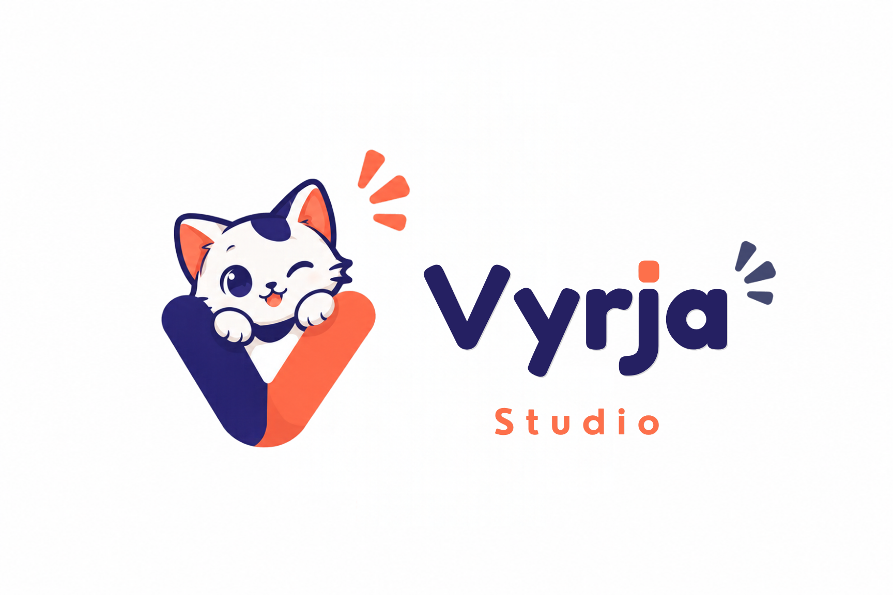

  

<h1 align="center">Vyrja Classroom</h1>

  <b>Software manajemen kelas open source dari Vyrja Studio</b> 
  Pantau, bimbing, dan ajar kelas di lab komputer — semua dari meja guru.

  
  
  
  

---

## Apa itu Vyrja Classroom?

Vyrja Classroom adalah aplikasi gratis dan open source untuk memantau serta
mengendalikan komputer-komputer di kelas atau lab, lintas platform. Guru bisa
mengawasi aktivitas siswa, membantu dari jarak jauh, dan menjaga kelas tetap
fokus — tanpa harus berkeliling ruangan.

> **Vyrja Classroom bukan Veyon.** Aplikasi ini adalah *fork* yang di-*rebrand*
> dan ditingkatkan dari [Veyon](https://veyon.io) 4.11.4 oleh **Vyrja Studio**.
> Kode dasarnya berasal dari Veyon, tetapi nama, tampilan, dan pengalamannya
> adalah khas Vyrja. Daftar lengkap perbedaannya ada di [VYRJA.md](VYRJA.md).

## Fitur utama

* **Pantau kelas** — lihat semua layar komputer siswa dalam satu tampilan
* **Remote access** — lihat atau kendalikan komputer siswa untuk membantu mereka
* **Mode demo** — siarkan layar guru ke semua siswa secara realtime (fullscreen atau jendela)
* **Kunci layar** — bekukan layar siswa saat guru menjelaskan, agar perhatian terpusat
* **Pesan teks** — kirim pengumuman atau instruksi ke siswa
* **Login & logout massal** — mulai dan akhiri sesi kelas untuk semua siswa sekaligus
* **Screenshot** — dokumentasikan progres belajar siswa
* **Jalankan program & situs** — buka aplikasi dan URL di komputer siswa dari jarak jauh
* **Distribusi materi** — kirim dan buka dokumen, gambar, dan video di komputer siswa
* **Administrasi daya** — nyalakan, matikan, dan restart komputer siswa dari jarak jauh

## Yang baru khas Vyrja

* **Quick Setup wizard** — pasang kelas dalam hitungan menit. Guru membuat kunci
  kelas, menyimpan file kunci untuk siswa, lalu memindai jaringan untuk
  menemukan PC siswa secara otomatis. Siswa cukup memilih file kunci guru.
  Tanpa konfigurasi kunci/autentikasi manual.
* **Command palette (Ctrl+K)** — ketik "kunci", "lock", "message"… dan jalankan
  aksi apa pun langsung dari keyboard.
* **Quick class** — menu fokus kelas (kunci semua), pengumuman, timer istirahat
  dengan buka-kunci otomatis, timer kerja dengan peringatan 5 menit, dan ekspor
  absensi ke CSV.
* **Status live** — penghitung komputer online / offline / bermasalah di header
  dan jumlah komputer terpilih di status bar, diperbarui setiap detik.
* **Bahasa Indonesia** — antarmuka Master dan Setup diterjemahkan penuh.
* **Tema Vyrja** — identitas visual navy `#26236B`, oranye `#FF6B4A`, dan krem
  `#FAF9FD`, dengan varian terang dan gelap.

## Unduh & pasang

Installer siap pakai tersedia di halaman
[**Releases**](https://github.com/MHFADev/vyrja-class/releases):

* **Windows** — installer `.exe` (64-bit)
* **Linux** — paket `.deb` untuk Ubuntu 24.04 dan Debian 12

Mau build sendiri dari source? Lihat [BUILDING.md](BUILDING.md).

## Berdasarkan Veyon

Vyrja Classroom dibangun di atas [Veyon](https://veyon.io) 4.11.4, software
manajemen kelas open source oleh Tobias Junghans / Veyon Solutions. Seluruh
pemberitahuan hak cipta upstream dipertahankan, dan dialog About di aplikasi
tetap mencantumkan kredit untuk Veyon.

## Lisensi

Vyrja Classroom dilisensikan di bawah **GPL-2.0-or-later**, sama seperti
upstream — lihat berkas [COPYING](COPYING) untuk teks lengkap GNU General
Public License.

Copyright (c) 2004-2026 Tobias Junghans / Veyon Solutions (kode upstream).
Modifikasi, branding, dan fitur tambahan © Vyrja Studio.
